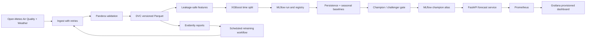

# Architecture

All timestamps are normalized to UTC after joining the Open-Meteo hourly series. Local cyclic time features use `Asia/Kolkata`. Air-quality observations are CAMS model estimates and should not be interpreted as ground-station measurements; see [MODEL_CARD.md](MODEL_CARD.md).

## Runtime boundaries

- `ingest` calls Open-Meteo and writes date-named Parquet under `data/raw/`.
- `validate` checks required columns, target range, null fraction, uniqueness, and timestamp continuity before writing the validated dataset.
- `features` uses only observations available at prediction time and labels each row with PM2.5 24 hours ahead.
- `train` and `evaluate` use chronological splits and log the model and baseline metrics to MLflow.
- `promote` assigns the `champion` model alias only after its configured evaluation gate passes.
- The API loads that alias at startup or accepts `AQ_MODEL_URI` for local/offline use. `/ready` indicates whether a model is available.
- Prometheus scrapes API counters, latency, prediction distribution, and model version. Grafana provisions its datasource and dashboard from `docker/grafana/`.

The hosted DVC remote and MLflow tracking server require DagsHub credentials. The GitHub workflow additionally needs those secrets and a deployment platform configuration before a public service can be created.
